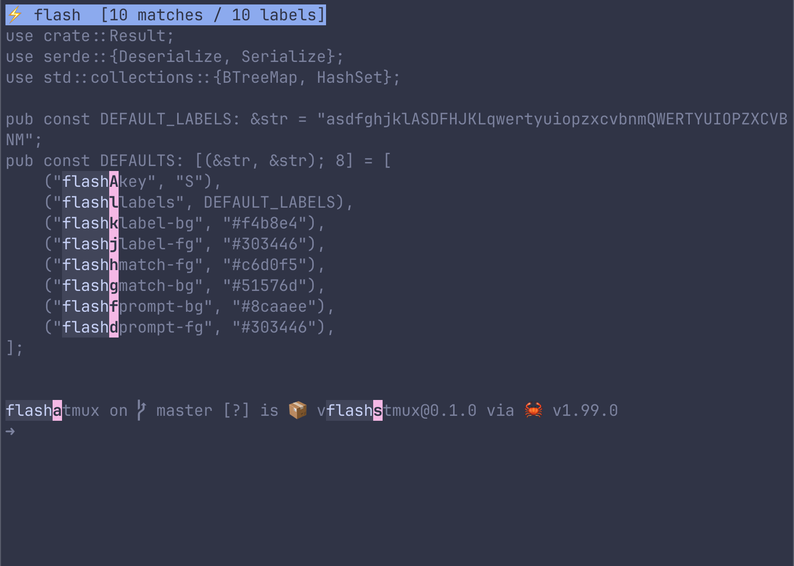
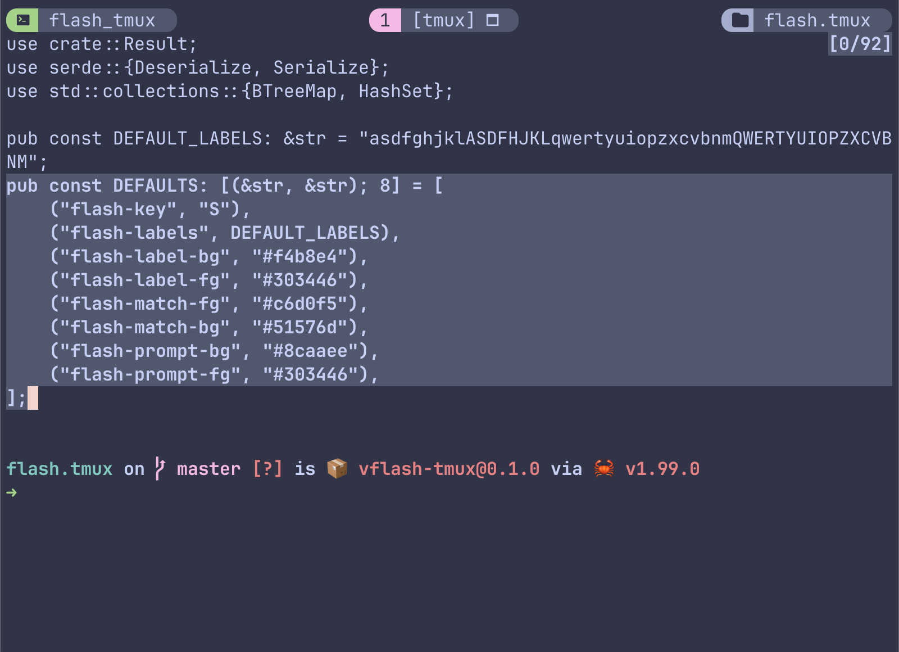
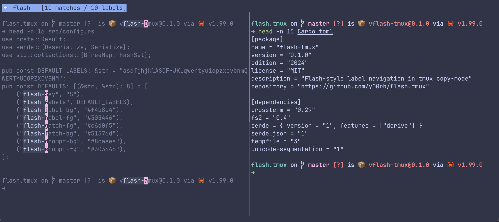
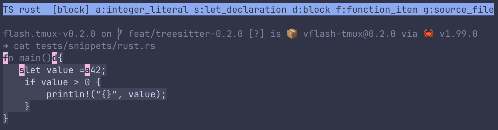
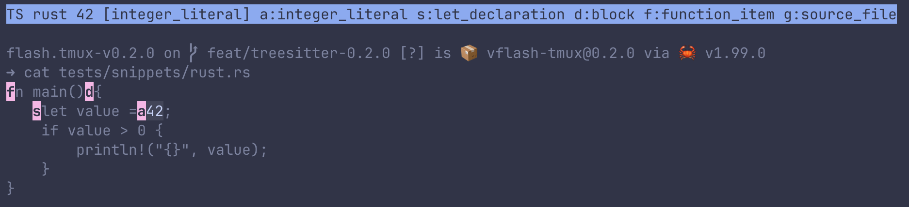
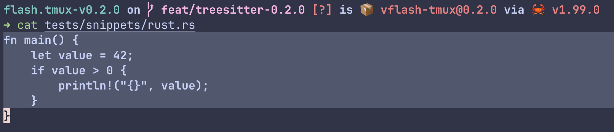

# flash.tmux

English | [简体中文](README.zh-CN.md)

Incremental search, label navigation, and Tree-sitter range selection in tmux copy-mode, inspired by [flash.nvim](https://github.com/folke/flash.nvim) by [folke](https://github.com/folke), with a Rust runtime and a small TPM entrypoint.

## Screenshots and Walkthrough

Captured in Ghostty with zsh, JetBrains Mono, and the Catppuccin Frappe theme, using this repository's actual files. These examples use vi copy-mode with `v` configured to begin selection. Selection, copy, pane-navigation, and split bindings are your tmux settings, not bindings installed by flash.tmux.

### 1. Search and Jump Labels

**Steps:** In the repository, run `head -n 16 src/config.rs`. Enter copy-mode with `prefix + [`, press `s`, and type `flash`. Pause before choosing a label.

**What to look for:** The blue `⚡` prompt shows the query and match/label counts. Matches are highlighted and pink single-character labels appear beside them. Press one of the displayed labels to jump to that match's start. Labels depend on the current cursor and visible text; use the labels on your screen rather than memorizing those in the image.



### 2. Extend a Selection with Search

**Steps:** From the same file output, start in copy-mode with no active selection:

```text
s → DEFAULTS: → Enter → 0 → v
s → flash-prompt-fg → Enter → j → $
```

The first search locates the declaration; `0` moves to the line start and `v` anchors the selection. The second search extends it toward the last option; `j` and `$` include the closing `];` line.

**What to look for:** The complete `DEFAULTS` block is selected and search labels have disappeared. This frame shows the completed selection stage. Next, press your configured `y` key to copy. With a non-exiting copy action such as tmux-yank's `copy-pipe`, you stay in copy-mode and can repeat the search/select/copy cycle.



### 3. Search Only the Active Pane

**Steps:** Leave copy-mode and split the window left/right using your tmux binding (`prefix + h` in this setup). Run `head -n 15 Cargo.toml` in the right pane. In the left pane, run `head -n 16 src/config.rs`, enter copy-mode, press `s`, and type `flash-`. Pause before choosing a label.

**What to look for:** Only the left pane is dimmed and annotated with matches and labels. The right pane keeps its normal colors and has no search labels. The blue `⚡` prompt shows the query and match/label counts.



### 4. Expand a Syntax Selection at the Cursor

**Steps:** From the checkout root, run `cat tests/snippets/rust.rs`. Enter copy-mode, move the cursor onto `42`, and press `S`. Press `;` twice: first to preview `let_declaration`, then `block`. Pause before pressing Enter. Use `,` to shrink the range again, or Esc to cancel.

**What to look for:** The function body is previewed and the prompt identifies the current node as `[block]`. Pink labels offer direct access to other enclosing nodes. This is an overlay preview, not a committed tmux selection; Enter confirms it.



### 5. Search Text and Choose an Enclosing Syntax Range

**Steps:** In the same visible Rust example, cancel the previous preview with Esc and move the cursor elsewhere in the code. Press `R`, type `42`, and pause before selecting a label or pressing Enter.

**What to look for:** The query finds `42`, while labels identify its `integer_literal`, `let_declaration`, `block`, and `function_item` ranges. Choose the label for the structure you want, not just the matched text. The displayed letters depend on the current results; `;` and `,` do not expand/shrink in this search mode.



### 6. Select a Complete Function From a Search Hit

**Steps:** Continue from case 5 and press the label shown beside `function_item` in the prompt. Pause after the popup closes, before copying or cancelling the selection.

**What to look for:** The whole function is selected, from `fn main()` through the final `}`. The shell command and prompt are excluded, and the syntax labels have disappeared. Press your own copy binding to copy the range while keeping your normal tmux workflow.



## Requirements

- tmux 3.3 or newer with popup support; currently tested locally on tmux 3.6a, macOS arm64.
- A visible tmux status line at the top or bottom. Search uses the message line for its prompt so that no source row is hidden. `status off` is rejected without modifying the pane.
- A true-color terminal for the default Catppuccin Frappe colors.
- A compatible prebuilt binary, or Rust 1.90+ / Cargo and a C compiler to build from source. Rust is not needed to run a prebuilt binary. Python 3.11+ is only used by development/release tests.
- For automatic installation: Git, curl, tar, and either sha256sum or shasum. Public GitHub releases must be reachable.

## Features

- **Incremental search (`s`)**: type as much visible text as you need, then jump with a label or Enter. Literal matching uses smart case and Unicode-aware cursor positioning.
- **Query-safe labels**: a key that could continue the current search is not assigned as a jump label, so typing and label selection do not compete.
- **Syntax selection (`S`)**: select the named node under the cursor or one of its ancestors. Expand with `;`, shrink with `,`, or choose a range label directly.
- **Syntax search (`R`)**: search for text and choose an enclosing declaration, block, or function without first navigating to the match.
- **Built-in language parsers**: 15 Tree-sitter grammars, automatic detection by default, and optional per-pane language overrides. No Neovim or external Tree-sitter installation required.
- **Selection-aware copying**: ordinary search extends an existing selection; syntax selection creates an exact characterwise range. Your own copy bindings and clipboard setup stay in control.
- **Active-pane isolation**: search and syntax navigation stay within the visible content of the current pane, without swapping or resizing it.
- **Safe previews and cancellation**: previews leave the real cursor and selection untouched; Esc/Ctrl+C cancels, and changed viewport/state invalidates pending syntax actions.

## Local Development / Source Installation

Replace `/path/to/flash.tmux` with your own checkout directory:

```sh
git clone https://github.com/y00rb/flash.tmux.git /path/to/flash.tmux
cd /path/to/flash.tmux
cargo build
```

Add the following to `tmux.conf`, using the same checkout path:

```tmux
set -g @flash-bin '/path/to/flash.tmux/target/debug/flash-tmux'
run-shell 'sh /path/to/flash.tmux/flash.tmux'
```

Reload your tmux configuration to load the plugin. After source changes, run `cargo build` again. Binary-only updates do not require a reload; binding or option changes do.

For an optimized build, run `cargo build --release` and point `@flash-bin` to `/path/to/flash.tmux/target/release/flash-tmux` instead.

An explicit `@flash-bin` always bypasses release downloads, even if the path is invalid (an error is shown instead). Loading never runs Cargo, and pressing s never builds or downloads.

## TPM and Prebuilt Releases

Configure TPM with a published version tag:

```tmux
# Put this before TPM initialization; use a published version tag.
set -g @plugin 'y00rb/flash.tmux#v0.2.0'
```

Press `prefix + I`. TPM clones and loads the plugin; `flash.tmux` then installs the binary required by the checked-out `VERSION` into the plugin's `bin/` directory. It identifies OWNER/REPO from the public GitHub HTTPS/SSH origin, never downloads `latest`, and does not require Rust. A compatible installed binary is reused without network access. Private/authenticated release downloads are not supported automatically.

Pinned tags are detached checkouts: TPM's `prefix + U` uses `git pull` and does not switch them to a new tag. Change the configured tag, then explicitly fetch/check out the new tag in the installed plugin directory and reload the plugin:

```sh
PLUGIN_DIR='/path/to/tpm/plugins/flash.tmux'
git -C "$PLUGIN_DIR" fetch origin tag v0.2.0
git -C "$PLUGIN_DIR" checkout --detach v0.2.0
```

Use the actual directory/version and inspect local changes before checkout; do not force it. Verify the checkout and `bin/flash-tmux --version` agree after loading. For branch-tracking installs without `#tag`, `prefix + U` can pull branch changes; wait for the matching Release to exist before updating. The entrypoint synchronizes the binary when loaded. An unavailable release reports an error; an incompatible old executable is not used for search.

For local development, keep `@flash-bin` set. Remove that override from your config and run `tmux set-option -gu @flash-bin` before reloading to test a Release install; deleting a config line alone does not clear a running tmux server's option. If a download fails, wait until the Release is available and reload the plugin, or run `sh scripts/ensure.sh` from its directory. Search never downloads.

You can also install a specific published version manually:

```sh
# Run from the installed plugin directory; substitute the actual repository/tag.
sh scripts/install.sh --version v0.2.0 --repo y00rb/flash.tmux
```

The installer chooses macOS arm64/x86_64 or Linux arm64/x86_64 musl, verifies SHA-256 and the program version, then replaces `bin/flash-tmux` atomically and records its version/platform in `bin/install-info`. It preserves the prior binary if download, verification or execution fails. Concurrent installers are serialized; if an installer is forcibly killed, inspect `bin/.install-lock/pid` and confirm its process has exited before removing that stale lock and retrying. Unsupported/offline systems can use a source build with `@flash-bin`.

Publishing is triggered by pushing a `vX.Y.Z` tag. `VERSION`, Cargo.toml and the tag must agree. Release depends on successful checks, builds all four targets, verifies binary versions and prepares complete draft assets before publishing. Failed draft uploads can resume; published releases are never overwritten. Use a new version for fixes. Prereleases are marked accordingly; ordinary branch pushes never publish a Release.

Linux musl builds aim to avoid glibc-version dependence; they are not a guarantee of support for every kernel, terminal or distribution. Checksums protect against corruption, not a compromised publisher or release channel.

## Usage

1. Enter tmux copy-mode, normally `prefix + [`.
2. Press **s** (lowercase).
3. Type visible text to narrow literal matches.
4. Press a displayed label to jump to the start of its match, or Enter to choose the nearest match.
5. Press s again for another search.

The prompt appears as `⚡ query  [3 matches / 3 labels]`, with a Frappe Blue background by default. Matches use a slightly brighter Surface1 background; labels keep their Pink background.

Backspace removes one grapheme. Esc or Ctrl+C cancels search without changing the original cursor/selection. Enter with no matches stays in search. Lowercase queries are case-insensitive; uppercase queries are case-sensitive. Labels are single ASCII characters; upper/lowercase labels are separate keys. A label that could continue any match is not used, so further typing remains possible. If there are too many matches, narrow the query.

Labels normally appear immediately after matches. At a row edge, a safe neighboring cell may be used instead. Where no safe cell is available, that match remains highlighted without a label; narrowing the query and Enter still reaches it. Searches do not cross wrapped screen-row boundaries and do not search offscreen history. Scroll first, then search.

The original pane is neither swapped nor resized. A resize or changed copy-mode state cancels a pending jump. Only one search per pane or client can run simultaneously. Search cancellation caused by closing the popup from tmux also leaves copy-mode intact.

## Selection and Repeated Copying

The plugin does not bind **v**, **y** or **q**, change clipboard settings, or depend on tmux-yank. Use your own copy-mode bindings:

```text
s -> search -> label -> v -> s -> search -> label -> y
```

Jumping extends an existing selection. Whether y exits copy-mode is entirely determined by your own binding. With tmux-yank, configure before TPM initialization:

```tmux
set -g @yank_action 'copy-pipe'
```

Then y copies without exiting, and you can repeat search/select/y until q exits. Later bindings can override tmux-yank; check the effective binding with `tmux list-keys -T copy-mode-vi y`.

During search, q and s are ordinary query characters or assigned labels, not exit/restart commands. Cancel search with Esc first if you want q to invoke your normal copy-mode exit binding. With an exiting y binding, re-enter copy-mode before using s again.

## Syntax Selection

| Key | Purpose | While Active |
| --- | --- | --- |
| `s` | Search text and jump to its start | Type a query; select a label or Enter |
| `S` | Select syntax around the current cursor | `;` expands, `,` shrinks; label or Enter confirms |
| `R` | Search text and select its enclosing syntax | Type a query; select a range label or Enter |

`S` and `R` are independent entrypoints. With the cursor on `42`, `S` previews
its smallest named node, then lets you expand to a declaration, block, or
function. With `R`, search for `42` and choose the `let_declaration` or
`function_item` label directly. Enter chooses the nearest hit's smallest range.
In `R`, `;` and `,` are query characters or labels, not range-cycling commands.
You can use `R -> query -> Enter -> S` when you prefer stepwise expansion.

Syntax previews do not change the real pane. Confirming replaces the old
selection with a characterwise range; it does not copy or exit copy-mode.
Esc/Ctrl+C cancels without changing the original cursor/selection. Copy using
your own binding. `s` still extends an existing selection instead of replacing it.
Overlapping node boundaries also appear in the prompt legend; labels overlay
cells and never insert or shift source text. Label letters depend on the query.

### Languages and Cat Fixtures

Built-in parsers: Rust, Python, JavaScript, TypeScript, TSX, JSON, Bash, C, C++,
Go, Lua, Ruby, Zig, PHP, Java. No Neovim, external Tree-sitter CLI, or runtime
grammar download is needed. Embedded licenses are in THIRD_PARTY_LICENSES.md.

```sh
# From the checkout root, in the pane being tested:
cat tests/snippets/rust.rs
# Enter copy-mode, move onto value/42, and press S; or use R and search 42.
# If detection is ambiguous, choose an explicit language:
tmux set-option -p @flash-treesitter-language rust
# Remove the pane override to inherit the global setting:
tmux set-option -pu @flash-treesitter-language
```

`auto` is the default; no language command is needed for normal use. An explicit pane override remains active until changed or unset.

See [all 15 fixtures and commands](tests/snippets/README.md). Canonical overrides
are `rust`, `python`, `javascript`, `typescript`, `tsx`, `json`, `bash`, `c`, `cpp`,
`go`, `lua`, `ruby`, `zig`, `php`, `java`; aliases include `js`, `ts`, `sh`, `rb`,
and `c++`. Pane overrides take precedence over the global option.

`auto` uses grammar-validated syntax near the cursor, not a source-file name.
It conservatively rejects ambiguity (for example C/C++ common syntax). Recovery
looks back at most 32 logical lines, examines up to 16 following line breaks,
and limits each local fragment to 8 KiB. Detection/parsing shares a 250 ms budget;
source input is capped at 256 KiB. Large/truncated declarations or mixed output
may require an explicit language. Only visible text is available: clipped wrapped
lines are rejected rather than selected at guessed coordinates. Language
injections, cross-window operations, editor operator-pending mode, and Neovim's
zero-cell inline virtual labels are not supported. This is core workflow
compatibility, not complete flash.nvim equivalence.

## Configuration

Configure options **before TPM initialization or manual plugin loading**. Unset options receive defaults; user values are not overwritten. Trigger keys must be distinct. The plugin replaces native copy-mode actions at the configured keys and preserves user-replaced bindings on reload.

```tmux
set -g @flash-key 's'
set -g @flash-treesitter-key 'S'
set -g @flash-treesitter-search-key 'R'
set -g @flash-treesitter-language 'auto'
set -g @flash-labels 'asdfghjklASDFHJKLqwertyuiopzxcvbnmQWERTYUIOPZXCVBNM'
set -g @flash-label-bg '#f4b8e4'   # Frappe Pink
set -g @flash-label-fg '#303446'   # Base
set -g @flash-match-fg '#c6d0f5'   # Text
set -g @flash-match-bg '#51576d'   # Surface1
set -g @flash-prompt-bg '#8caaee'  # Blue
set -g @flash-prompt-fg '#303446'  # Base
```

Colors accept `#RRGGBB`. Empty match/prompt backgrounds use the terminal default; empty foregrounds or label backgrounds are invalid. Labels must be unique printable non-space ASCII characters. The trigger accepts tmux key names, is registered only in the `copy-mode` and `copy-mode-vi` key tables, and does not capture Neovim keys outside tmux copy-mode.

`@flash-bin` optionally overrides the executable path for local builds. The plugin tracks `@flash-bound-key` internally to remove its previous trigger on reload without deleting user replacement bindings.

## Testing

```sh
cargo fmt --check
cargo clippy --all-targets -- -D warnings
cargo test
cargo build
python3 tests/tmux_probe.py
python3 tests/e2e.py
python3 tests/treesitter_e2e.py
sh tests/plugin.sh
sh tests/install.sh
python3 tests/bootstrap_test.py
python3 tests/release_version_test.py
python3 tests/publish_test.py
python3 scripts/check-release.py --binary target/debug/flash-tmux
```

Maintainers also run `python3 scripts/check-release.py --tag v0.2.0` before pushing a release tag, using the intended version. Bootstrap tests mock GitHub downloads and exercise the entrypoint in an isolated tmux server. Publishing tests mock `gh`, including draft recovery and refusal to overwrite public releases; they do not publish anything.

The Python terminal tests create unique, disposable tmux servers and PTYs, never your live session. Clipboard operations in tests are replaced with local temporary-file commands. Neovim geometry coverage runs when `nvim` is available. Installer tests use local download mocks and require no network.

Captured tabs use standard eight-column tab stops; custom terminal tab stops are not verified. Unicode tests cover CJK, combining accents, basic emoji, a ZWJ sequence and regional-indicator flags on the tested tmux. Terminal/tmux Unicode tables can differ on other versions; report rendering or jump mismatches with both versions. Input and matching preserve literal Unicode sequences rather than normalizing composed/decomposed forms.

## Runtime Files

The executable uses a private directory at `$XDG_CACHE_HOME/flash-tmux` or `~/.cache/flash-tmux` for per-pane/per-client OS locks and private search snapshots. Normal searches clean their temporary snapshots; the next search for a pane cleans stale snapshots from a crashed search. Small lock files remain reusable and OS locks are released automatically on process exit.
